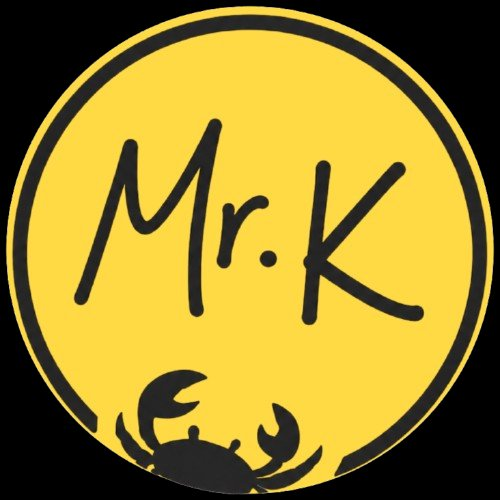

# MR K — Premium Digital Growth Agency Website

Official production-ready frontend for **MR K**, a premier creative digital branding, web engineering, and business growth company based in **Tiruchirappalli (Trichy), Tamil Nadu, India**.



---

## 🌟 Brand Overview

- **Brand Name:** MR K
- **Tagline:** BUILD. BRAND. GROW.
- **Headquarters:** Tiruchirappalli (Trichy), Tamil Nadu, India
- **WhatsApp Consultation:** [+91 8270374293](https://wa.me/918270374293)
- **Specialization:** Digital Branding, Personal Branding, Social Media Marketing, Cinematic Video Production (Reels), Modern Web Development, Meta/Google Ads, Local SEO, and AI Automation.

---

## 🎨 Brand Design System & Palette

- **Primary Accent Yellow:** `#FFD943`
- **Deep Black (Canvas):** `#080808`
- **Secondary Black (Cards & Panels):** `#111111`
- **Charcoal (Elevated Surfaces):** `#1A1A1A` / `#222222`
- **Warm White (Headings & Copy):** `#F5F2E9`
- **Brand Grey (Subtext & Meta):** `#A1A1AA`
- **Typography:** Space Grotesk (Display/Headings), Inter (Clean UI/Body), Sora (Accents).

---

## ⚡ Tech Stack

- **Framework:** React 18
- **Build Tool:** Vite 5
- **Styling:** Tailwind CSS 3 with custom brand theme
- **3D Graphics:** Three.js (custom WebGL ambient sphere sculpture with mouse parallax & battery-saving IntersectionObserver)
- **Animations:** Framer Motion
- **Icons:** Lucide React
- **Celebration Effects:** Canvas Confetti
- **Deployment:** Vercel (Frontend only, zero backend dependencies)

---

## 🚀 Key Sections & Features

1. **Cinematic Hero Section:**
   - Editorial headline: *"WE BUILD BRANDS THAT PEOPLE REMEMBER."*
   - Interactive 3D brand sculpture inspired by the circular MR K logo with gold orbital rings and dynamic lighting.
   - Mouse parallax on desktop, battery-optimized on mobile with auto-pause on scroll.
   - Direct CTA hooks to project enquiry and portfolio.

2. **Accurate Trust & Credibility Statistics:**
   - 10+ Companies Served
   - 100% Focus on Quality
   - 360° Digital Solutions
   - Trichy Based, Worldwide Vision
   - Animated count-up triggers.

3. **About MR K:**
   - Authentic founder-led introduction and core philosophy.
   - Mission and vision statements.
   - Highlight of the original circular MR K logo emblem.

4. **Comprehensive Services (7 Core Capabilities):**
   - Service 01: Brand Identity & Personal Branding
   - Service 02: Social Media Management
   - Service 03: Video Production & Creative Media (Reels)
   - Service 04: Website Development
   - Service 05: Digital Marketing & Advertising (Meta/Google Ads)
   - Service 06: Local SEO & Business Growth (Trichy)
   - Service 07: AI & Business Automation
   - Each with deliverables, hover interactions, and direct WhatsApp quote triggers.

5. **Selected Portfolio / Case Studies:**
   - Filterable categories: All, Branding, Social Media, Website Development, Video Production, Digital Campaigns.
   - Interactive case details modal with outcomes and stack specifications.
   - Authentic, editable data configuration.

6. **Brands That Trust MR K:**
   - Logo wall / badge grid featuring 10+ established company relationships across diverse Tamil Nadu industries.

7. **Verified Client Testimonials:**
   - Interactive testimonial slider with star ratings, verified badges, and client roles.

8. **Transparent Pricing & Packages (INR ₹):**
   - Monthly Retainers: Starter (₹3,999/mo), Business Growth (₹7,999/mo - Popular), Premium Growth (₹14,999/mo).
   - Website Development: Landing page (₹4,999+), Business (₹8,999+), Premium (₹18,999+), E-commerce (₹29,999+).
   - Clear terms (ad spend separation, shoot scoping, revision cycles).

9. **Trichy Local Business Presence (Local SEO Engine):**
   - Natural keyword architecture targeting Trichy and Tamil Nadu markets.
   - Commercial localities covered: Thillai Nagar, Cantonment, Tennur, Srirangam, Woraiyur, KK Nagar, Thiruverumbur, Puthur, Anna Nagar, Palakarai.

10. **Customer Acquisition System:**
    - Full project enquiry form with client name, business name, WhatsApp, location, service, and budget.
    - Frontend input validation and celebration feedback.
    - Automatically encodes and launches formatted WhatsApp messages to `+91 8270374293` using the official `https://wa.me/918270374293` pattern.

11. **Interactive Polish:**
    - Custom desktop cursor with trailing glow.
    - Floating pulsating WhatsApp button.
    - Reading scroll progress indicator.
    - Smooth scroll-to-top button.
    - Interactive FAQ accordion.

---

## 🛠️ Local Development & Build

```bash
# 1. Install dependencies
npm install

# 2. Run local development server
npm run dev

# 3. Build optimized production assets
npm run build

# 4. Preview production build locally
npm run preview
```

---

## 🌐 Vercel Deployment Guide

This project is 100% frontend and requires zero backend configuration:

1. Push this repository to GitHub / GitLab / Bitbucket.
2. Go to [Vercel](https://vercel.com) and click **"Add New Project"**.
3. Import the repository.
4. Framework Preset will automatically detect **Vite**.
5. Build Command: `npm run build`
6. Output Directory: `dist`
7. Click **Deploy**.

`vercel.json` is already pre-configured with SPA route fallbacks and asset caching headers.

---

© 2026 MR K. All Rights Reserved.
